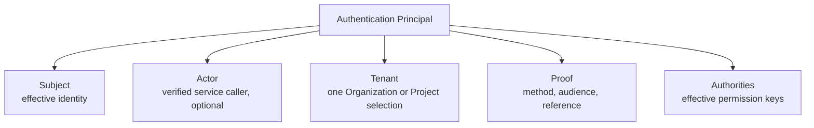
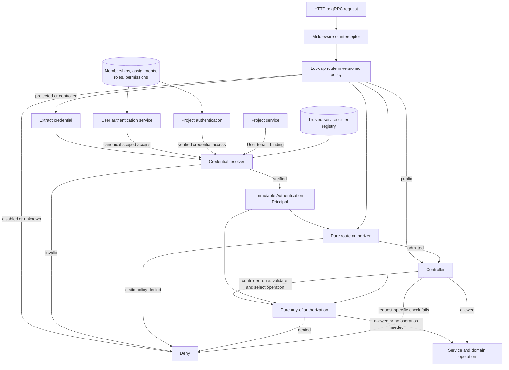
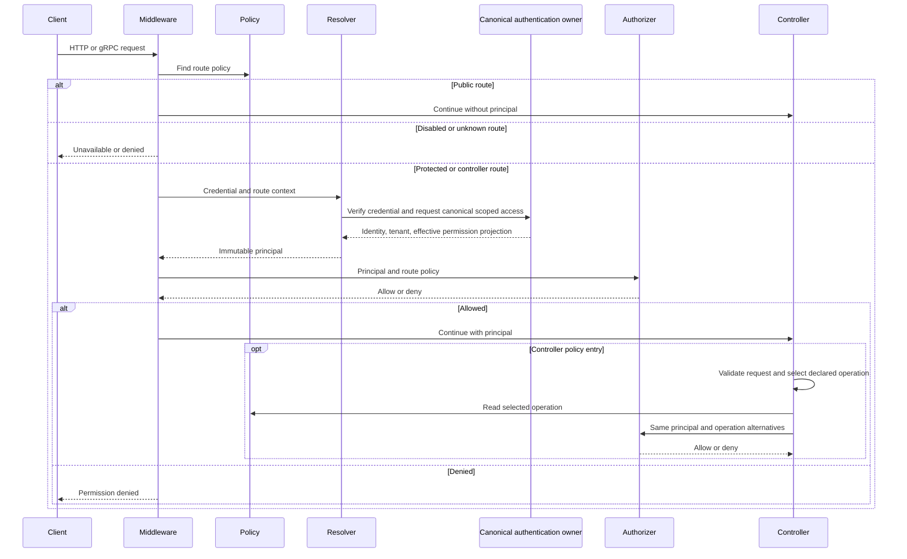

# RFC 0054: Unified Authentication Principal

- Status: Accepted
- Owner: Access Management
- Approved by: Repository owner
- Date: 2026-11-11
- Supersedes: RFC 0053 authentication-context, private-sidecar, and effective-permission-resolution ownership only

## Context

The current authentication model spreads verified request facts across
`types.Authentication`, credential-specific scope types, and planned private authorization
sidecars. That makes a route decision depend on both authentication state and additional database
or sidecar lookups. It also makes delegation difficult to describe consistently because the
authenticated caller, effective subject, selected tenant, credential proof, and permissions do not
have one contract.

The accepted Access Management direction needs four authentication forms:

- a user session;
- a Project credential;
- an Organization credential;
- a service assertion, optionally acting for a user, Project credential, or Organization
  credential.

Every protected request must be resolved against one selected tenant before route authorization.
The route authorizer must then decide from two inputs only: the versioned route policy and an
immutable authentication principal. It must not query the database, call a service, or retrieve a
second authorization object.

RFC 0053 assigns effective-permission resolution and verified authorization facts to route
authorization and private sidecars. This RFC intentionally changes that ownership. It does not
change RFC 0053's disabled-route decisions, unique service-key requirements, transaction rules,
rollback floor, or other accepted Access Management behavior.

This is a Governed authentication and authorization contract. Runtime implementation cannot begin
until this RFC is accepted.

## Decision

Introduce one immutable request-scoped `authentication.Principal`. Successful construction means
the request is authenticated. The principal contains the complete verified facts required for
static route authorization:

```go
type Principal struct {
	subject       Identity
	actor         *ServiceActor
	tenant        Tenant
	proof         Proof
	authorities   []PermissionKey
}

type Identity struct {
	Type   IdentityType
	ID     uint64
	Issuer string
}

type ServiceActor struct {
	ID     uint64
	Issuer string
}

type Tenant struct {
	OrganizationID uint64
	ProjectID      uint64
}

type Proof struct {
	Method    AuthenticationMethod
	Audience  Audience
	Reference ProofReference
}

type ProofReference struct {
	Type  ProofReferenceType
	Value string
}

```

The principal package declares closed string types and constants:

```go
type PermissionKey string
type IdentityType string
type AuthenticationMethod string
type Audience string
type ProofReferenceType string

const (
	IdentityUser                   IdentityType = "user"
	IdentityProjectCredential      IdentityType = "project"
	IdentityOrganizationCredential IdentityType = "organization"
	IdentityService                IdentityType = "service"

	AuthenticationUserSession            AuthenticationMethod = "user_session"
	AuthenticationProjectCredential      AuthenticationMethod = "project_credential"
	AuthenticationOrganizationCredential AuthenticationMethod = "organization_credential"
	AuthenticationServiceAssertion       AuthenticationMethod = "service_assertion"

	AudienceNone           Audience = ""
	AudienceManagement     Audience = "management"
	AudienceRapidaInternal Audience = "rapida_internal"

	ProofReferenceUserSession ProofReferenceType = "user_session"
	ProofReferenceCredential  ProofReferenceType = "credential"
	ProofReferenceSigningKey  ProofReferenceType = "signing_key"

)
```

The constructors and accessors are fixed:

```go
func NewDirectPrincipal(
	subject Identity,
	tenant Tenant,
	proof Proof,
	authorities []PermissionKey,
) (Principal, error)

func NewDelegatedPrincipal(
	subject Identity,
	actor ServiceActor,
	tenant Tenant,
	proof Proof,
	authorities []PermissionKey,
) (Principal, error)

func (p Principal) Subject() Identity
func (p Principal) Actor() (ServiceActor, bool)
func (p Principal) Caller() Identity
func (p Principal) Tenant() Tenant
func (p Principal) Proof() Proof
func (p Principal) Authorities() []PermissionKey
```

All `Principal` fields are private. Constructors copy caller-owned slices; accessors return values
and fresh slice copies. There is no mutable `IsAuthenticated` flag. Callers receive a principal
only after all constructor invariants pass. Two constructors make the trust boundary explicit:

- `NewDirectPrincipal` creates a principal whose subject presented the verified credential;
- `NewDelegatedPrincipal` creates a principal whose service actor presented a verified assertion
  for the subject.

`Caller() Identity` returns the service actor converted to a Service identity when delegation is
present. Otherwise it returns the subject. `Subject()` always returns the effective identity used
for actor and permission policy. `Authorities()` always returns a copy.

### Identity contract

The identity type determines what `Identity.ID` references:

| Identity type | ID referent | Issuer |
| --- | --- | --- |
| User | User record ID | Empty |
| ProjectCredential | Project credential record ID, not Project entity ID | Empty |
| OrganizationCredential | Organization credential record ID | Empty |
| Service | Configured durable service actor ID | Required |

The serialized policy actor `project` maps to the Go identity type `ProjectCredential`. The longer
Go name prevents confusion with the Project entity in `Tenant.ProjectID` while preserving the
already reviewed policy vocabulary.

Every required ID is from 1 through `math.MaxInt64`. Issuers are trimmed, nonblank where required,
and contain no NUL. The policy value `system` remains reserved but unsupported in V1 because the
trusted-caller registry has no accepted System-subject mapping. Startup rejects a current route
that declares `system`; adding one requires a separate accepted identity-source contract.

### Subject and tenant matrix

A principal represents one tenant selection. It does not support tenant switching after
construction.

| Subject | Empty tenant | Organization tenant | Project tenant |
| --- | --- | --- | --- |
| User | Allowed | Allowed | Allowed |
| ProjectCredential | Denied | Denied | Required |
| OrganizationCredential | Denied | Required | Denied |
| Service | Allowed | Allowed | Allowed |

An empty tenant has both IDs zero. An Organization tenant has a nonzero Organization ID and a zero
Project ID. A Project tenant has both IDs nonzero. A Project ID without an Organization ID is
always invalid.

### Proof contract

`Proof` states how the immediate caller was authenticated. It does not contain raw credentials,
tokens, secrets, role records, or user profile data.

| Method | Direct subject | Required audience | Required reference |
| --- | --- | --- | --- |
| UserSession | User | None | UserSession reference |
| ProjectCredential | ProjectCredential | Management | Credential reference equal to the decimal subject ID |
| OrganizationCredential | OrganizationCredential | None | Credential reference equal to the decimal subject ID |
| ServiceAssertion | Service, or any allowed delegated subject | RapidaInternal | SigningKey reference |

The service assertion actor is always a `ServiceActor` with a configured durable ID and nonblank
issuer. Only a successfully verified service assertion may add an actor. For a delegated principal,
the subject is asserted by the verified actor. Its trust derives entirely from that actor and the
resolver's delegation checks. `NewDirectPrincipal` accepts `ServiceAssertion` only for a Service
subject. `NewDelegatedPrincipal` requires `ServiceAssertion`, a non-Service subject, and a distinct
verified Service actor.

`ProofReference.Value` is a nonsecret correlation value. It is trimmed, contains no NUL, and is 1
through 200 Unicode code points. Its referent is fixed by type:

- `UserSession` identifies the verified session or token record;
- `Credential` is the canonical base-10 credential ID and must equal the direct Project or
  Organization credential subject ID;
- `SigningKey` identifies the configured service assertion key used for verification.

The signing-key reference supports audit correlation and key rotation. It does not promise
per-assertion replay detection or revocation.

Construction enforces the complete cross-field matrix:

| Principal path | Actor | Proof |
| --- | --- | --- |
| Direct User | Absent | UserSession, no audience |
| Direct ProjectCredential | Absent | ProjectCredential, Management |
| Direct OrganizationCredential | Absent | OrganizationCredential, no audience |
| Direct Service | Absent | ServiceAssertion, RapidaInternal |
| Delegated User | Required Service | ServiceAssertion, RapidaInternal |
| Delegated ProjectCredential | Required Service | ServiceAssertion, RapidaInternal |
| Delegated OrganizationCredential | Required Service | ServiceAssertion, RapidaInternal |

Direct Runtime credentials are not constructible in V1 because the current credential model has
no accepted deployment or resource binding. A future token-class contract must add that binding
before direct Runtime credentials become valid.

### Effective authorities

Authorities are resolved on every protected request, but the credential resolver does not become a
second role-catalog owner. For a User subject, the RFC 0049 user authentication service remains the
sole owner of active assignment reads, active role and role-permission reads, and Organization and
per-Project permission unions. Its existing scoped authentication projection is the canonical
input to both the public authentication response and principal construction.

The User credential resolver verifies the credential through that service, selects the requested
tenant, and maps the canonical Organization projection plus at most one exact selected-Project
projection into the principal. For a Project tenant it composes those two already-resolved
projections when the Project projection exists, then deduplicates and sorts the final keys. Project
tenant selection is separate from Project-role possession: the Project service must verify that the
selected Project is active and belongs to the canonical Organization, but absence of a canonical
Project projection is valid and contributes no Project permissions. The resolver does not query
assignment or role-catalog tables and does not independently resolve either scoped union. Project
authentication retains ownership of its active `PROJECT_TOKEN` role and effective Project
permissions under RFC 0052 and RFC 0053. OrganizationCredential and Service subjects have no V1
authorities.

Missing or duplicate required Organization projections, duplicate selected-Project projections,
an inactive or cross-Organization Project selection, an Organization mismatch, blank or malformed
permission keys, service failure, cancellation, or deadline deny closed. A User may select an
active Project in the current Organization without a Project assignment; the principal then
contains the Project tenant, canonical Organization authorities, and no Project authorities. A
User may also retain an Organization tenant and authorize an operation on an active Project in that
Organization when the request carries its target Project separately. There is no fallback to
feature permissions or direct role-catalog reads.

The principal stores effective permission keys only. It does not store roles, assignments,
permission-definition records, or database models. This avoids duplicate authorization models while
making the principal a complete input to route policy.

Authority composition is closed for V1:

| Effective subject and tenant | Included authorities |
| --- | --- |
| User, empty tenant | None |
| User, Organization tenant | Active Organization permissions for `Tenant.OrganizationID` |
| User, Project tenant | Active Organization permissions for `Tenant.OrganizationID`, plus active Project permissions for `Tenant.ProjectID` only when its canonical Project projection exists |
| ProjectCredential, Project tenant | Active Project permissions from the credential's active assigned `PROJECT_TOKEN` role for `Tenant.ProjectID` |
| OrganizationCredential, Organization tenant | None |
| Service, any allowed tenant | None |

A delegated subject follows the same authority row as its effective subject. Project-tenant user
composition includes both scopes so a declared Organization-or-Project policy branch can be
evaluated without another lookup. Permission-key prefixes keep the Organization and Project
authorities distinguishable after deduplication. Absence of authorities is valid and causes a
permission-bearing branch to deny.

Authorities are a request snapshot. A revocation committed after static route admission does not
retroactively stop an in-flight read. A sensitive mutation that depends on current authority must
lock and reread its authorization inputs inside the owning service transaction, as RFC 0053 already
requires for authority-changing operations.

### Project-token interpretation

Project-token eligibility is derived from existing principal facts. It is not stored as another
field:

| Principal facts | Derived Project-token audience |
| --- | --- |
| Direct ProjectCredential subject, no actor, ProjectCredential proof | Management |
| ProjectCredential subject, verified Service actor, ServiceAssertion proof | Runtime |
| Any other subject | Not applicable |

Both Project paths require an exact Organization and Project tenant binding. Service delegation may
not produce Management Project-token authority. The Runtime case is valid only when the service
actor, internal proof audience, asserted ProjectCredential subject, and tenant binding satisfy the
accepted service-caller and delegation contract from RFC 0052 as retained by RFC 0053.

The `project_token` predicate is conditional on the effective subject. A ProjectCredential subject
must satisfy the derived audience and tenant binding. A non-Project subject does not evaluate this
predicate, even when the mixed-actor route entry declares `project_token` for its Project branch.

Audience ordering matches RFC 0052. A Management policy requirement accepts only Management
access. A Runtime policy requirement accepts Runtime or Management access. This lets the current
confidential Management credential call Runtime routes while preventing delegated Runtime access
from calling Management routes.

### Authentication assurance

The current V1 policy keeps recent-MFA-dependent routes disabled. This RFC does not invent an MFA
or assurance field before that contract exists. `Principal + route policy` is sufficient for every
currently enabled V1 static route decision.

A separately accepted recent-MFA contract must add typed, server-derived assurance facts to the
principal before an assurance-dependent route is enabled. The route authorizer will not use a
private sidecar as a fallback.

### Policy context compatibility

Policy context is evaluated against the effective subject and selected tenant after the route or
alternative actor check. Delegation does not change this matrix; `caller_services` evaluates the
immediate Service actor separately.

| Policy context | Allowed effective subjects | Required tenant |
| --- | --- | --- |
| `user` | User | Empty, Organization, or Project |
| `organization` | User, OrganizationCredential, Service | Organization or Project |
| `project` | User, ProjectCredential, Service | Project |
| `controller` | No direct match | The selected operation's alternatives each declare one concrete context above |

`user` is identity-bound and selects no tenant authority. This preserves self-service and
onboarding access whether or not the User also selected an Organization or Project.

`organization` uses exactly `Tenant.OrganizationID`. A Project tenant may satisfy Organization
context because it contains the selected Organization and a User principal includes that
Organization's canonical authorities. A ProjectCredential never satisfies Organization context.
For a controller operation using an Organization alternative, a target Project need not appear in
the principal. The controller must prove that the target Project is active and belongs to exactly
`Tenant.OrganizationID` before authorization. This preserves Organization-level lifecycle and
emergency-revocation authority without granting Project permissions. When the protobuf request has
no Project ID, the operation requires a Project tenant and uses `Tenant.ProjectID` as the target;
that selection remains valid without a canonical Project permission projection.

`project` requires both tenant IDs and uses exactly `Tenant.OrganizationID` and
`Tenant.ProjectID`. Any target Project must equal `Tenant.ProjectID`. An OrganizationCredential
never satisfies Project context.

A `controller` parent performs no context match. Every alternative inside the selected operation
is evaluated through the same concrete-context matrix. A missing context, an incompatible subject,
an Organization target outside `Tenant.OrganizationID`, an Organization-alternative Project target
not proven active in that Organization, or a Project-alternative target that differs from either
tenant ID denies closed.

### Route policy interpretation

The route authorizer is a pure evaluator. Given a resolved principal and one route policy entry, it
applies these mappings:

| Policy field | Principal fact |
| --- | --- |
| `actors` | `Subject().Type` |
| `caller_services` | delegated service actor, or direct Service subject |
| `context` | selected `Tenant` and subject binding |
| `permissions` | effective `Authorities` |
| `project_token` | audience derived from subject, actor, and proof plus exact tenant binding, only for a ProjectCredential subject |

When `caller_services` is present, the immediate service caller must match an exact configured
issuer and actor ID. When it is absent, a delegated service caller is evaluated as its effective
subject, preserving RFC 0052 behavior. Authentication resolution still rejects an untrusted actor.

`public` routes bypass credential resolution. `disabled` routes return unavailable without
invoking a controller. Missing routes, unknown policy values, malformed principals, unsupported
credential types, and failed predicates deny closed.

For `controller` policy entries, middleware first verifies the entry's allowed actor and the
conditional Project-token predicate. The controller then validates the typed request, determines
exactly one declared operation, and enforces the context-shaped resource rules above. It passes the
selected operation and the same principal to the pure authorizer. The controller never selects an
authorization alternative based on the principal's authorities.

Each operation contains one or more `any_of` alternatives. An alternative declares allowed actors,
one concrete context, and either an authenticated predicate or an all-of permission list. The pure
authorizer allows when one complete alternative matches. Multiple matching alternatives are valid.
Parent route requirements always apply, and an alternative may narrow but never broaden parent
actors, caller services, or Project-token requirements. Missing or unknown operations, zero
alternatives, malformed alternatives, or no matching alternative deny through one generic error
before resource disclosure or service work.

The accepted controller selection tables from RFC 0052 and RFC 0053 move into the versioned policy
as named operations before enforcement. Deterministic routes may have several operations, each
with one alternative. Provider metadata has one selected operation with a User-only Organization
alternative requiring `organization.provider_credentials.read_metadata` and a User and
ProjectCredential Project alternative requiring `project.provider_credentials.read_metadata`.
The authorizer, not the controller, evaluates both alternatives as one accepted any-of decision.
`ScopeAuthorize` uses request-selected Organization and Project operations with their respective
OrganizationCredential and ProjectCredential alternatives, so a Project subject cannot select the
authenticated Organization path. The controller owns only deterministic operation selection and
tenant/resource validation.

The provider metadata shape is representative:

```yaml
authorization: controller
actors: [user, project]
context: controller
project_token:
  audience: management
  binding: project
operations:
  metadata:
    any_of:
      - actors: [user]
        context: organization
        permissions: [organization.provider_credentials.read_metadata]
      - actors: [user, project]
        context: project
        permissions: [project.provider_credentials.read_metadata]
```

### Credential selection

HTTP and gRPC adapters use one deterministic credential-family selector before invoking a
resolver. The request keys and their meanings do not change:

| Family | Complete credential |
| --- | --- |
| User | `authorization` and `x-auth-id`; `x-project-id` is an optional tenant selection |
| Project | `x-api-key` |
| Organization | `x-org-key` |
| Service | `x-internal-service-key` |

For a User credential, `x-project-id` selects both the Project tenant and the target Project for a
controller operation whose protobuf request has no Project ID, including provider metadata. It does
not assert Project membership or permission. The resolver asks the Project service to verify that
the selected Project is active and belongs to the canonical Organization. An absent canonical
Project projection therefore yields an empty Project authority contribution rather than an
authentication failure.

A protected route requires exactly one complete credential family. Zero families, any partial User
credential, a blank selected value, or more than one credential family is invalid and rejects
before resolver invocation. There is no credential-family precedence and middleware order cannot
change the selected identity.

HTTP preserves the current source order inside one family. User `authorization` uses path, then
header, then query. User `x-auth-id` and `x-project-id` use header, then path, then query. Project,
Organization, and Service credentials use header, then query, then path. Once a higher-priority
source supplies a nonblank value, lower-priority copies of that same key are ignored. gRPC accepts
incoming metadata only and rejects duplicate values for a credential key. All selected values are
trimmed before completeness checks. Public routes do not inspect credentials.

### Principal structure



### Complete request flow



The role catalog and assignment graph connect only to their accepted authentication-service owners.
The User resolver consumes RFC 0049's canonical scoped projection and a Project-service tenant
binding; it does not read or recompute the authorization graph. Neither the persistence graph nor
an authentication service connects to the route authorizer.



## Contracts and Ownership

- `pkg/authentication` owns the principal value types, constructor invariants, and immutable
  accessors.
- Credential resolvers own credential verification, selected-tenant binding, delegation checks,
  fail-closed mapping of canonical authentication results, and principal construction. They do not
  own role-catalog resolution.
- The RFC 0049 user authentication service remains the sole owner of active user-assignment reads,
  Organization and per-Project permission unions, and the scoped projection used by the public
  authentication response and User principal construction. A User resolver may compose the
  canonical Organization and exact selected-Project projections, but it never recomputes either
  union.
- The Project service owns active Project existence and Organization binding for a User's
  `x-project-id` tenant selection. Validating that binding does not grant Project membership or
  synthesize a Project permission projection.
- Project authentication owns ProjectCredential validity, tenant binding, active assigned
  `PROJECT_TOKEN` role, and effective Project permissions. OrganizationCredential and Service
  subjects have no V1 authorities.
- Memberships, role assignments, role definitions, role-permission rows, permission definitions,
  credential records, and the service caller registry remain their authoritative sources. The
  principal is an immutable per-request snapshot, not a second persistence source.
- HTTP middleware and gRPC interceptors own route lookup, credential extraction, resolver
  invocation, static route authorization, failure mapping, and attaching the principal to request
  context.
- The authentication middleware package owns one credential-family selection contract shared by
  Gin, unary gRPC, and streaming gRPC adapters. Adapter order is not an authentication input.
- The route authorizer owns only the pure comparison of one principal with one policy entry. It has
  no database, service, role-catalog, assignment, or sidecar dependency.
- The versioned policy owns every named controller operation and its authorization alternatives.
  Controllers own typed request validation through `pkg/validator`, deterministic operation
  selection, and tenant/resource validation. They never select an alternative based on possessed
  permissions. The pure authorizer owns the operation's any-of decision. Services retain
  persistence and domain-operation ownership.
- `pkg/errors` owns a centralized `AuthenticationPrincipalInvalidError`. Constructor failures do
  not expose credentials, proof references, permissions, or internal records.
- Public authentication request messages remain unchanged. The RFC 0049 public scoped access
  projection and principal authorities use the same canonical user-service result. The existing
  `types.Authentication` remains in use until the governed cutover replaces it; no compatibility
  fields are added to it.
- No private authorization sidecar is used after the principal cutover. RFC 0053 clauses assigning
  permission, Project-token facts, or future assurance consumption to sidecars are superseded. RFC
  0053's controller-selected authorizer decisions remain accepted and move into named policy
  operations. RFC 0049 authority-resolution ownership remains accepted. All other RFC 0053
  decisions remain accepted.
- Feature permissions are not an authority source or fallback. Their deprecation remains a
  separate change.

## Alternatives Rejected

- Resolve permissions inside the route authorizer: rejected because it gives a pure policy
  evaluator persistence ownership and makes a route decision depend on hidden inputs.
- Let every deployable resolve User assignments directly: rejected because it conflicts with RFC
  0049 and creates permission-union implementations that can drift from the public authentication
  projection.
- Let a controller choose the permission alternative the caller possesses: rejected because it
  moves authorization into transport code. The controller selects an operation; the pure
  authorizer evaluates all declared alternatives.
- Carry role assignments and role definitions in the principal: rejected because policy consumes
  effective permission keys, and copying the role graph would create a second authorization model.
- Keep permission and Project-token sidecars: rejected because multiple request authorization
  objects weaken the contract that principal plus policy is sufficient.
- Use one generic map of claims: rejected because misspelled keys, wrong value types, and illegal
  combinations would become runtime policy behavior instead of constructor failures.
- Model Organization and Project access as repeated permission-scope structs: rejected because one
  request has one selected tenant, so repeated scope values duplicate tenant identity.
- Store a separate Project-access source or audience: rejected because direct and delegated paths
  are already closed combinations of subject, actor, proof, and tenant. Another field would
  duplicate those facts.
- Add recent MFA now: rejected because there is no accepted assurance source, freshness rule, or
  lifecycle. A field without that contract would imply security that the system cannot verify.
- Add a separate principal for every credential kind: rejected because middleware and policy need
  one closed contract, while constructor rules already preserve credential-specific invariants.

## Consequences and Risks

| Area | Impact or reason for N/A |
| --- | --- |
| Compatibility | Public request messages do not change. The RFC 0049 scoped projection remains canonical and must equal User principal authority inputs. `x-project-id` may select an active same-Organization Project without a Project assignment but grants no Project authority. Internal middleware, resolvers, and controllers require a governed cutover from `types.Authentication`. RFC 0053 sidecar and route-authorizer permission-resolution ownership is intentionally superseded. |
| Failure and recovery | Resolver failure, stale binding, unknown policy, or invalid principal denies before controller execution. The existing authentication path remains the rollback target until the atomic cutover is verified. |
| Security and privacy | The principal contains only verified identity, tenant, proof metadata, and effective permission keys. It excludes raw credentials, secrets, roles, profiles, feature permissions, and duplicate Project-token facts. Logs must not serialize the whole principal. |
| Data and migration | No table or column is introduced. Correct resolution depends on the RFC 0047 and 0049 role-assignment cutover and existing migration prerequisites from RFC 0053. |
| Concurrency and resources | Authorities are a per-request snapshot. Sensitive mutations lock and reread authorization inputs in the service transaction. No cache, background worker, timer, or retained resource is introduced. |
| Operations and observability | Authentication failures, canonical-projection failures, principal-construction failures, static policy denials, and controller denials must remain distinguishable without logging credentials or full authority sets. Resolver latency includes canonical authentication-owner calls on every protected request. |

## Rollout and Rollback

1. Add the unwired principal value types, closed constructors, centralized invalid-principal error,
   and package tests. Do not change request authentication or middleware behavior in this stage.
2. Complete the RFC 0049 canonical scoped projection and stop downstream User authenticators from
   discarding its roles or effective permissions. Implement Project-service tenant binding that is
   independent of Project-role possession, then map canonical User access and Project-authentication
   results into complete principals. Add tests for every credential, delegation, tenant, authority,
   and Project-token path.
3. Move every accepted controller selection into named versioned-policy operations. Implement the
   pure policy evaluator, deterministic credential selector, and HTTP and gRPC adapters. Validate
   complete policy route inventory and all fail-closed paths with enforcement still off.
4. Complete RFC 0047 and 0049 prerequisites and the RFC 0053 service-key migration. Inventory every
   delegated service caller and route before enabling principal enforcement.
5. Deploy the middleware, resolver, policy evaluator, and embedded policy atomically. Remove
   equivalent legacy runtime authorization only after parity tests pass. Do not maintain a dual
   fallback that accepts either incomplete principals or legacy role strings.

Stop rollout on an uncovered route, missing resolver binding, stale assignment behavior, unknown
permission, service-caller mismatch, Project audience mismatch, authentication latency regression,
or unresolved Critical or Major review finding.

Before enforcement, rollback removes only unwired principal code. After enforcement, rollback uses
the RFC 0053 unique-key-only safety-floor artifact and its matching configuration. It must retain
disabled routes and exact trusted service-caller verification. No schema rollback is introduced by
this RFC.

## Verification

Acceptance requires tests that prove:

- every direct and delegated identity accepts only its closed proof and tenant combinations;
- the principal constructor accepts only a structurally valid Service actor; resolver integration
  tests prove the actor came from cryptographic verification and the trusted caller registry;
- `system` is not constructible or allowed by a V1 route;
- direct credential proof references exactly match their credential subject IDs;
- authorities reject blank keys, are deduplicated and sorted, and cannot be mutated through an
  accessor or by changing the caller-owned input slice after construction;
- Project-tenant users receive the exact Organization authority union plus the exact selected
  Project authority union when that canonical projection exists; absence contributes no Project
  authority, and every other subject and tenant pair receives only the declared authority set;
- the User principal maps the RFC 0049 canonical Organization and optional exact selected-Project
  projections, matches the public scoped access projection, and performs no assignment or
  role-catalog read;
- missing required Organization or duplicate selected-Project projections, inactive or
  cross-Organization Project selection, Organization mismatch, malformed permission keys,
  authentication-owner failure, cancellation, and deadline deny closed;
- Project-token interpretation derives direct Management and delegated Runtime from the closed
  subject, actor, proof, and tenant combinations, and rejects direct Runtime, delegated Management,
  non-Project application, and every tenant mismatch;
- `project_token` is skipped for non-Project subjects, Management requirements accept only
  Management, and Runtime requirements accept Runtime or Management;
- caller-services policy checks the immediate service caller while actor policy checks the
  effective subject;
- every subject, `user`, `organization`, `project`, and tenant combination matches the closed
  context matrix, including Project-tenant User access to its Organization and every incompatible
  credential denial;
- zero, partial, multiple, and duplicate credential-family inputs fail deterministically across
  Gin, unary gRPC, and streaming gRPC, while existing per-key HTTP source order remains stable;
- every permission decision uses only the principal authority snapshot and policy entry;
- every controller decision selects exactly one operation without inspecting possessed
  permissions, and the pure authorizer evaluates all declared alternatives without a database or
  service call;
- provider metadata and Project credential lifecycle tests prove Organization-only permission,
  Project-only permission, both, and neither; both matching alternatives allow, while tenant or
  actor mismatch denies every alternative;
- provider metadata uses `x-project-id` as its target and Project tenant; an Organization
  administrator without a Project assignment receives no Project authorities but passes the
  Organization alternative after active same-Organization binding validation;
- an Organization-tenant administrator with the declared Organization permission and no target
  Project assignment can operate on an active Project proven to belong to that Organization;
  cross-Organization targets deny, while a Project alternative always requires the exact principal
  Project;
- policy startup rejects empty any-of sets, unknown operations, nonconcrete alternative contexts,
  and alternatives that broaden parent actors or Project-token requirements;
- the pure route authorizer has no database, service, assignment, role-catalog, or sidecar
  dependency;
- malformed credentials, principals, policy values, and unknown routes deny closed;
- public and disabled route behavior remains unchanged;
- the first stage has no runtime reference to the new principal; and
- centralized constructor errors expose no sensitive input.

Exact first-stage verification commands:

```bash
go test ./pkg/authentication/...
go test ./pkg/errors
go test ./pkg/types ./pkg/middlewares ./pkg/authenticators
test -z "$(gofmt -l pkg/authentication/principal.go pkg/authentication/principal_test.go pkg/errors/authentication_principal.go pkg/errors/authentication_principal_test.go)"
! rg -n 'authentication\.Principal|\*authentication\.Principal' --glob '*.go' --glob '!pkg/authentication/principal.go' --glob '!pkg/authentication/*_test.go'
awk '/[[:blank:]]$/ { print FILENAME ":" FNR; bad = 1 } END { exit bad }' pkg/authentication/principal.go pkg/authentication/principal_test.go pkg/errors/authentication_principal.go pkg/errors/authentication_principal_test.go rfcs/0054-unified-authentication-principal.md
git diff --check
just agent-finalize "pkg/authentication/principal.go,pkg/authentication/principal_test.go,pkg/errors/authentication_principal.go,pkg/errors/authentication_principal_test.go,rfcs/0054-unified-authentication-principal.md"
```

Later cutover stages add resolver, middleware, HTTP, gRPC, policy, delegation, database-failure,
concurrency, and end-to-end tests for every changed package before enforcement.

## Review and Approval

- Challenger: `/root/final_rfc_security`, `/root/final_rfc_contract`, and
  `/root/final_rfc_lifecycle_retry`
- Outcome: Approved
- Resolved findings: The repository owner selected a complete request principal and pure route
  authorizer, superseding the earlier sidecar and authorizer-owned permission-resolution direction.
  Review corrections made Project-token checks subject-conditional, closed the Project audience
  matrix without a duplicate Project-access field, defined exact authority composition, preserved
  controller-selected authorizer ownership, added actor-bound named policy operations, specified
  deterministic credential selection, closed the Go constructor contract, and required
  defensive-copy verification. All three reviewers approved the complete contract. Security and
  implementation reviewers separately approved removal of the redundant Project-access field and
  derivation of Project-token audience from subject, actor, proof, and tenant. The final approval
  panel then found three valid Major ambiguities. This correction adds the closed context matrix,
  makes controller selection choose one operation whose alternatives are authorizer-evaluated
  any-of paths, and preserves RFC 0049 as the canonical owner of User permission unions and scoped
  projections. Final security review additionally required Organization-level emergency revocation
  without Project assignment and a usable provider-metadata target. The accepted contract now
  separates active same-Organization Project tenant binding from Project-role possession, uses the
  existing `x-project-id` selection, and grants no Project authority when its canonical projection
  is absent. All final reviewers reported no unresolved Critical or Major findings.
- Open questions: None
- Approval reference: Repository owner conditional approval and explicit third-cycle resolution
  authorization on 2026-11-11; final independent Codex panel approval
